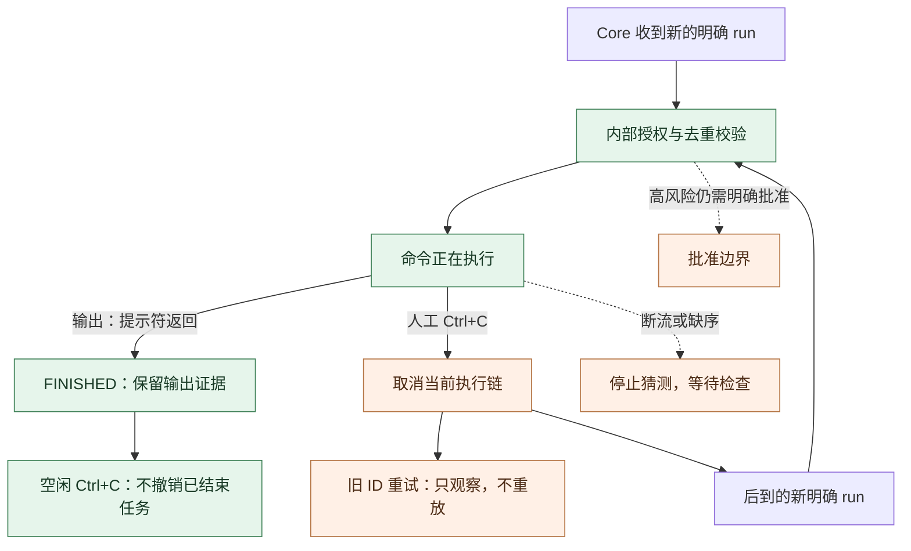
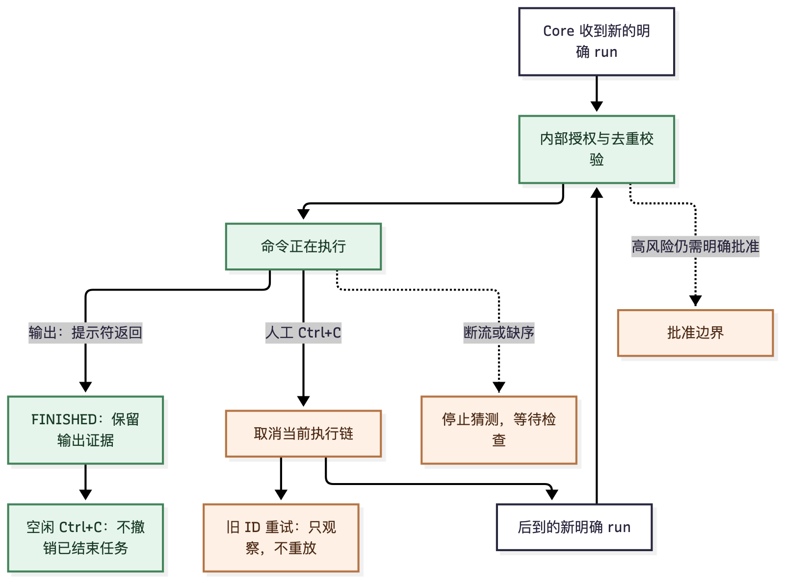
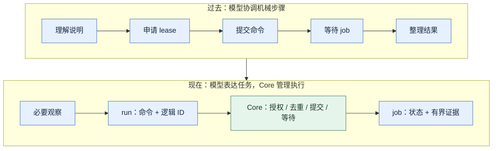
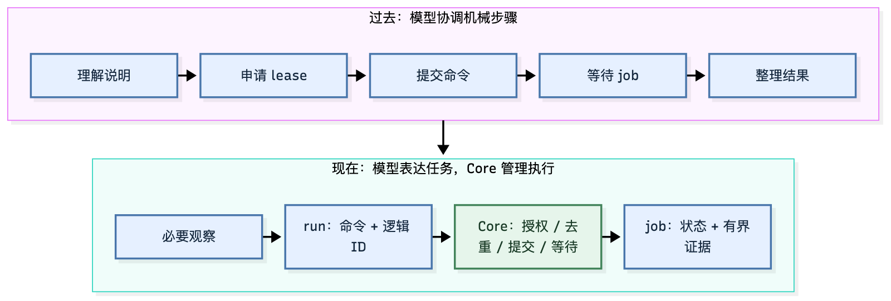

# Shared Terminal Bridge（十二）：让模型少管一点——从租约编排到任务接口与自发现

> **系列导航**：[系列目录](../README.md) · 上一篇：[第十一篇：与 Agent 一起重构](11-interactive-refactoring.md)

记录日期：2026-10-19。本篇整理 STB v0.16.0 与 STB-RDC v0.3.0 前后的实际调整。它不是接口手册，也不是严格性能实验；前面的文章保留为阶段快照，这里解释设计为什么继续变化。

## 一、功能已经可用，为什么交互依旧慢

第十一篇里，我主要解决的是开发维护成本：让人和陌生模型知道去哪里看、在哪里改、怎样验证。继续实操之后，我又遇到另一种成本：工具已经能正常执行，但每次发起一项简单检查，仍要等很久。

我让 ChatGPT 通过 STB-RDC 检查 DNS 解析情况，目标命令几十毫秒就能完成，整个工具阶段却跨越了几十秒。直觉上很容易把它归因于模型慢、网络慢，或者 Python 适配层慢。但把调用记录展开后，最显眼的是重复准备和机械往返。

模型先查用法，再读上下文、取得租约、提交命令、等待结果；有时还要确认是否真的完成。一次工具调用的本机处理只需几十到几百毫秒，两次调用之间却可能隔着数秒。

我意识到，终端工具把太多属于自身的协调工作暴露给了模型。模型本来应该判断“检查什么、证据说明什么、下一步是否安全”，却还要记住“先拿哪一个计数，再把它交给哪个接口”。

这轮调整的方向因此不是让模型更努力，而是把机械工作收回工具内部。

## 二、减负之前，先把人工中断定义清楚

最初的租约模型容易表述为：人按 Ctrl+C，就撤销当前授权。这对阻止旧决策很直观，但实际使用时范围过宽。

共享终端并不只属于模型。我可能在模型没有执行命令时，自己输入命令、取消输入，或者只是恢复提示符。这些操作不应该一概被解释为“我正在撤回模型授权”。

我把定义收窄为：**只有 STB 命令正在执行期间的人工 Ctrl+C，才取消该次执行链。** 空闲时的终端操作不算接管一个已经结束的任务。

这个判断不能交给模型。模型收到终端文字时，事件可能早已发生；它也不应该从一个 `^C` 字符猜测授权状态。因此，命令开始、终端输出和人工按键进入同一 pane 的有序事件流，由 Core 任务状态机处理。

[Mermaid 源文件](https://github.com/sharpbai/notion-assets/blob/main/tech/shared-terminal-bridge/12-human-interrupt.mmd) · [SVG](https://raw.githubusercontent.com/sharpbai/notion-assets/main/tech/shared-terminal-bridge/12-human-interrupt.svg) · [PNG](https://raw.githubusercontent.com/sharpbai/notion-assets/main/tech/shared-terminal-bridge/12-human-interrupt.png)

有序事件解决的是判定顺序，不会让提示符识别变成可信退出码。提示符返回仍是完成启发式，业务是否成功还要看输出证据；事件断流或缺序时，也不能凭猜测恢复执行。

## 三、授权仍然存在，但模型不再管理它

另一个摩擦来自重新授权。早期我曾尝试把 Codex thread、用户回合和租约严格关联，希望从身份上判断“这是不是新的人工意图”。但宿主元数据、会话恢复和不同客户端之间的差异，使正常工作背负了额外复杂度。

最终，我选择把普通续授权的依据放回本地：以 Bridge 收到调用的顺序为准。人工中断取消旧执行链，此后新收到的明确调用可以在内部取得新的执行权限；高风险操作仍要明确批准。

我不再要求模型申请、读取或传递 generation。它只表达“执行这条命令”“观察这个任务”“回复或中断这个任务”。Core 仍保存内部 lease、单增计数、事件关联和审计，并在真正输入之前严格校验。

这不是删除安全机制，而是改变接口的抽象层级。

同样，后到的新调用可以继续，不等于旧调用的后续步骤能自动复活。已取消的调用必须停止；重试、排队和进程恢复都不能成为绕过人工中断的理由。新调用也不能扩大我原来授权的任务范围。

## 四、从操作步骤接口，变成任务接口

既然授权管理属于 Core，就没必要让模型分别编排 lease、submit 和 wait。我把常规执行入口收敛为 `run`：一次调用在内部处理授权、去重、提交和等待，返回 job ID、状态和有界结果。

[Mermaid 源文件](https://github.com/sharpbai/notion-assets/blob/main/tech/shared-terminal-bridge/12-task-interface.mmd) · [SVG](https://raw.githubusercontent.com/sharpbai/notion-assets/main/tech/shared-terminal-bridge/12-task-interface.svg) · [PNG](https://raw.githubusercontent.com/sharpbai/notion-assets/main/tech/shared-terminal-bridge/12-task-interface.png)

后续交互也围绕任务，而不是当前 pane 的最新权限：input 和 interrupt 绑定原 job，旧 job 不能控制新任务。审批使用审批请求 ID，不自动变成命令执行。等待超时或取消观察，不等于给目标程序发送 Ctrl+C。

这里还有一项不能省略的机制：逻辑请求 ID 去重。

远程调用没有返回，不代表命令没有执行。如果模型因为没收到响应而换一个新 ID 重交，调用次数虽然减少，副作用却可能重复。因此 Core 在执行前持久化逻辑请求身份。同 ID 重试观察原任务，不重新输入；参数冲突或崩溃后无法确定执行状态时拒绝盲目重放。

这不是跨崩溃 exactly-once 的承诺，而是宁可报告不确定，也不猜测重发。少一次模型判断，必须由更多确定性约束来承接。

## 五、复杂命令为什么不能塞进启动字符串

这轮还修复了一个容易误判为“模型不会转义”的问题：命令通过多层 Shell 字符串传递时，可能在到达目标终端之前就被解释。

一次 awk 命令原本带有 `$1`、`$2`，进入 Core 后却成了空字段表达式。问题出在 RDC 启动 Adapter 的外层双引号：本地 zsh 已经提前展开了变量，目标命令内部的单引号无法保护另一层 Shell。

所以我没有继续堆转义规则，而是把启动程序与传递数据分开：固定启动 `stb-rdc serve-stdio`，取得 PID，再通过 stdin 发送一行 JSON。目标命令在 JSON 的 text 字段中传递，不进入本地启动字符串。

Codex MCP 则继续走结构化参数。两条路径在 Core 汇合，不额外展开美元符、引号或反斜杠。

最初的接收程序还曾保持运行。这使 RDC 即使已经读到响应，也可能等满输出收集窗口。我最终没有引入更复杂的 worker 复用，而是改为一个请求、一个响应、flush 后退出；下一条请求新启进程。

等待 stdin 的接收程序以 `timeout_ms=1` 尽快返回 PID，随后立即输入。这个数字不是目标命令的执行超时，也不适用于所有调用的结果收集。

这里解决的是传输可靠性，不是真正多行执行。当前仍不注入目标脚本、marker 或控制文件，也不假设目标环境装有 Python。命令传得正确，不代表命令本身写得正确。

## 六、自发现应该是入口，不是另一份长手册

执行步骤简化之后，首次发现又成了显眼成本。模型为了知道如何调用工具，先读 help，再读文档，再 bootstrap；甚至把 bootstrap 的终端行数从 4 改成 1 又调一次。

但 lines 只裁剪终端上下文，不会缩短固定规则。第二次发现没有必要。日志里输出过大被省略，也只是历史存储限制，不能直接认定模型当时没有收到完整结果。

我把两条入口分别收敛：

- STB MCP：连接后以 instructions 和工具 schema 自发现，移除重复的本地 STB skill。
- STB-RDC：知道固定入口后，一次只读 bootstrap 返回当前上下文、精简规则和请求模板；成功后直接 run，刷新终端用 context。
- CLI：保留命令帮助，额外加 Agent bootstrap 或 MCP 接入引导，不把完整协议复制到 usage。

两者并不是同一种“自动发现”。MCP 由客户端注册并提供工具；RDC 不会凭空知道本机安装了 stb-rdc，仍需用户、上下文或简短入口说明告诉它怎样启动。bootstrap 解决的是知道入口之后的用法发现。

同一测试上下文下，bootstrap 精简版约 2.98 KB，完整说明版约 5.39 KB，减少约 45%；实际返回仍随终端内容变化。完整解释按需获取，必要的人工中断、去重、风险批准和禁止旁路规则则保留。

我的目标不是让说明越短越好，而是让模型第一次容易找到，找到之后不必反复阅读。

## 七、用真实调用检验，而不是只凭感觉

在同一个 DNS 查询会话里，我比较了两轮相近任务：

| 指标 | 00:20 轮 | 00:30 轮 |
| --- | --- | --- |
| RDC 工具调用 | 7 次 | 5 次 |
| bootstrap | 2 次 | 1 次 |
| 实际 run | 2 次 | 1 次 |
| 首次至最后工具记录跨度 | 约 39 秒 | 约 25 秒 |
| RDC 本机处理累计 | 1.707 秒 | 0.379 秒 |
| Core job elapsed | 73 + 34 ms | 81 ms |

工具阶段跨度约缩短 36%。这次收益主要来自不再重复发现，以及把相关只读查询合并到一次 run，而不是目标命令显著变快。

我给这些数字保留了几个限制。两次查询范围不完全相同，不是严格 A/B 基准；job elapsed 已包含在 RDC 调用内，不能重复相加。剩余时间还包含模型编排、网络和平台调度，不能全算成推理。会话摘要与工具日志还出现过完成时间不一致，因此不据此计算精确的用户提问到最终回答耗时。

本轮仍有重复成本：模型读了 README，CLI bootstrap 用 1 ms 启动后又单独收取输出，serve-stdio 返回 PID 到输入 run 也隔了数秒。后续应区分可自行退出的只读发现与等待 stdin 的接收程序，而不是把所有启动都机械设为同一种超时。

理想冷启动可以是一次只读 bootstrap，加 run 的启动与输入，共约三次工具调用；已有当前契约时约两次。长任务、输出未收齐或环境变化仍需要额外观察，这不是每次必达的时延承诺。

我也不把调用轮次下降直接等同于实际 Token 或账户额度下降。少读重复内容、少做机械往返，确实减少了需要处理的信息；具体节省多少，仍要用固定任务和真实用量记录测量。

## 八、文档也必须成为低成本接口

最后，这轮又回到了第十一篇的问题：如果工具契约已经变了，当前文档却还夹着旧 lease/send 示例，模型就会花更多时间判断到底信哪一份。

我把 Core 和 Adapter 文档统一为使用、参考、开发、验证、历史五层。当前契约只在 reference 维护，日期调整进入 history/changes；验证目录维护可复现的回归和证据，不再不断追加跨日开发流水账。

这不是单纯整理目录。它要求我区分：已经实现、已经发布、运行进程已经加载、真实场景已经验收，以及还只是建议。自动测试通过不能替代真实 RDC 长等待验收，发布版本也不表示 daemon 自动重启。

本轮发布时，Core 默认测试共 144 项，9 项跳过；隔离宿主 tmux 测试 11 项通过，Adapter 测试 43 项通过，两仓库 GitHub CI 均通过。这些是当时快照，不是未来永远不变的数字。

## 结语：把严格留在内部，把注意力留给判断

这一轮调整之后，我更清楚地看到两种复杂度：业务本身需要模型理解的复杂度，以及工具自己制造出来的协调复杂度。

前者不能靠隐藏信息解决；后者则应该尽量用本地状态机、稳定任务身份、去重和清晰契约消化。

> 我希望工具内部足够严格，但对人和模型暴露的工作方式足够简单。模型应该花精力理解问题，而不是维护工具自己的状态。

## 代码与后续阅读

- [STB v0.16.0 发布](https://github.com/sharpbai/shared-terminal-bridge/releases/tag/v0.16.0)与 [STB-RDC v0.3.0 发布](https://github.com/sharpbai/shared-terminal-bridge-rdc/releases/tag/v0.3.0)。
- [Core 模型任务接口](https://github.com/sharpbai/shared-terminal-bridge/blob/v0.16.0/docs/reference/model-tasks.md)：此链接固定到发布版本；当前行为以运行能力和最新参考文档为准。
- [系列目录](../README.md)与 [第十一篇：交互式重构](11-interactive-refactoring.md)。
